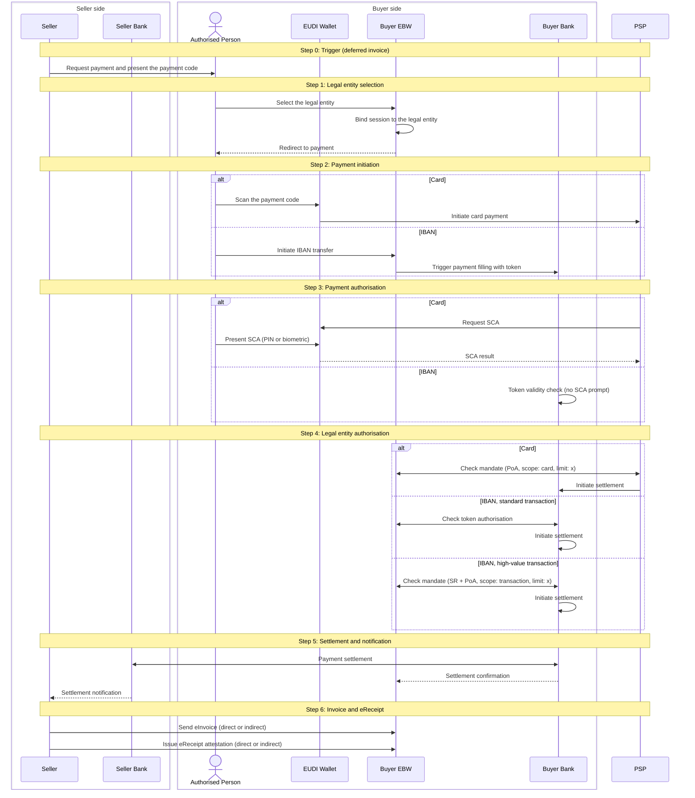

# Scenario 1: Deferred invoice, card or IBAN payment

The Seller requests payment first. The Authorised Person pays either by card through the EUDI Wallet, or by IBAN transfer from the Buyer EBW. On the card rail the PSP performs SCA against the wallet and checks the PoA mandate against the Buyer EBW. On the IBAN rail the Buyer Bank validates a token and, for high-value transactions, checks the SR and PoA mandate. After settlement the Seller delivers the eInvoice and the eReceipt. Overview and shared context: [repository README](../README.md).

## Steps

| Step | Name                               | What happens                                                                                                                                                                                                                                                                    |
| ---- | ---------------------------------- | ------------------------------------------------------------------------------------------------------------------------------------------------------------------------------------------------------------------------------------------------------------------------------- |
| 0    | Trigger                            | Seller requests payment and presents a payment code                                                                                                                                                                                                                             |
| 1    | Legal entity selection             | Authorised Person selects the legal entity in the Buyer EBW; the session is bound to it                                                                                                                                                                                         |
| 2    | Payment initiation                 | Card: Authorised Person scans the code with the EUDI Wallet, which initiates the payment with the PSP. IBAN: Authorised Person initiates the transfer from the Buyer EBW, which triggers payment filling at the Buyer Bank with a token                                         |
| 3    | Payment authorisation              | Card: PSP requests SCA from the EUDI Wallet; Authorised Person presents SCA (PIN or biometric). IBAN: Buyer Bank performs a token validity check, no SCA prompt                                                                                                                 |
| 4    | Legal entity payment authorisation | Card: PSP checks the mandate against the Buyer EBW (PoA, scope: card, limit: x) and initiates settlement with the Buyer Bank. IBAN standard: Buyer Bank checks the token authorisation. IBAN high-value: Buyer Bank checks the mandate (SR + PoA, scope: transaction, limit: x) |
| 5    | Settlement and notification        | Buyer Bank settles with Seller Bank; Buyer and Seller are notified                                                                                                                                                                                                              |
| 6    | Invoice and eReceipt               | Seller sends the eInvoice and issues the eReceipt to the Buyer EBW                                                                                                                                                                                                              |

- Inputs: Buyer EBW with SR and PoA; Authorised Person's EUDI Wallet with PID and SCA attestation.
- Outputs: settled payment; eInvoice and eReceipt in the Buyer EBW.
- Errors: code scan or token failure aborts before authorisation; SCA failure, invalid token, or missing or insufficient PoA or SR blocks settlement.

## Sequence diagram

