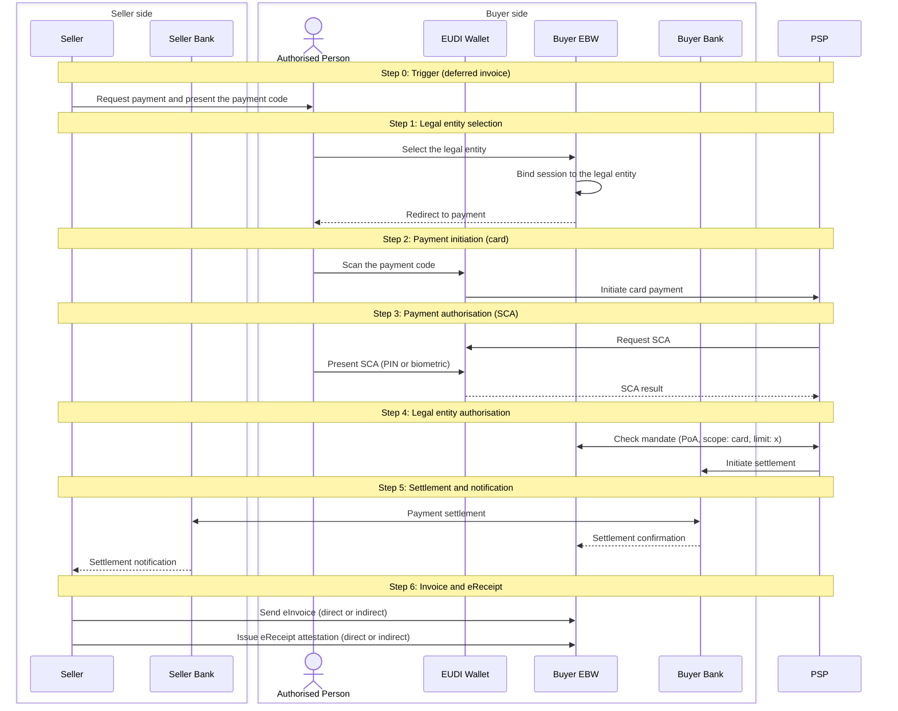

# Scenario 1: Deferred invoice, card payment

The Seller requests payment first. The Authorised Person pays by card through the EUDI Wallet. The PSP performs SCA against the wallet and checks the card mandate (PoA) against the Buyer EBW. After settlement the Seller delivers the eInvoice and the eReceipt. Overview and shared context: [repository README](../README.md).

## Steps

| Step | Name                               | What happens                                                                                                             |
| ---- | ---------------------------------- | ------------------------------------------------------------------------------------------------------------------------ |
| 0    | Trigger                            | Seller requests payment and presents a payment code                                                                      |
| 1    | Legal entity selection             | Authorised Person selects the legal entity in the Buyer EBW; the session is bound to it                                  |
| 2    | Payment initiation                 | Authorised Person scans the code with the EUDI Wallet; the wallet initiates the payment with the PSP                     |
| 3    | Payment authorisation              | PSP requests SCA from the EUDI Wallet; Authorised Person presents SCA (PIN or biometric)                                 |
| 4    | Legal entity payment authorisation | PSP checks the mandate against the Buyer EBW (PoA, scope: card, limit: x), then initiates settlement with the Buyer Bank |
| 5    | Settlement and notification        | Buyer Bank settles with Seller Bank; Buyer and Seller are notified                                                       |
| 6    | Invoice and eReceipt               | Seller sends the eInvoice and issues the eReceipt to the Buyer EBW                                                       |

- Inputs: Buyer EBW with SR and PoA; Authorised Person's EUDI Wallet with PID and SCA attestation.
- Outputs: settled card payment; eInvoice and eReceipt in the Buyer EBW.
- Errors: code scan failure, SCA failure, or missing or insufficient PoA. Payment is not settled.

## Sequence diagram

