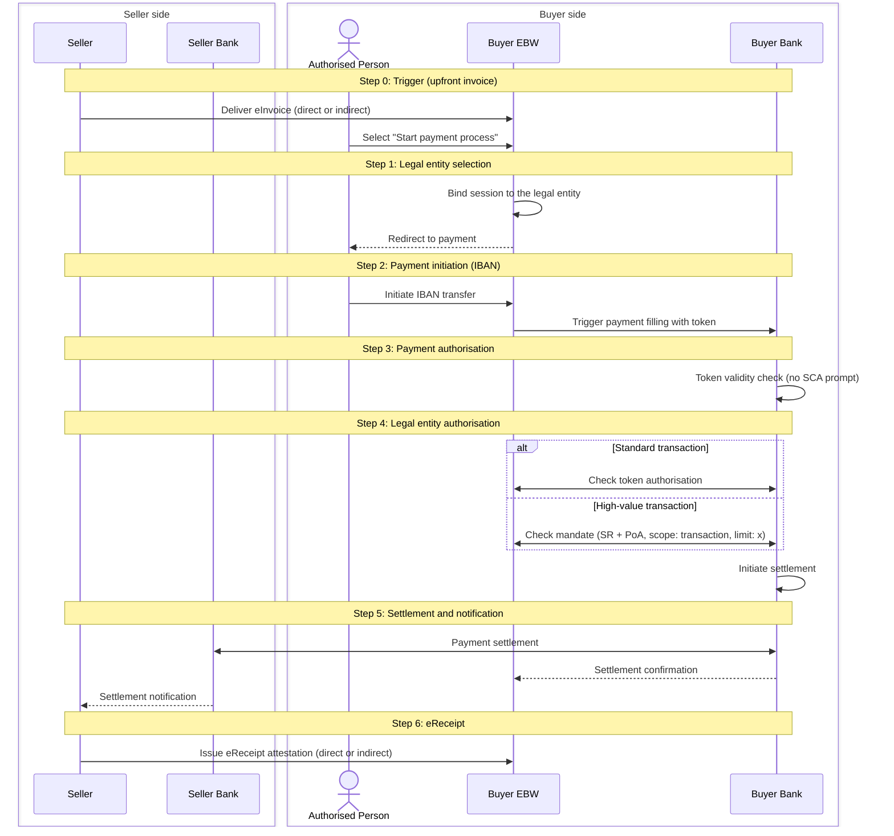

# Scenario 2: Upfront invoice, IBAN payment

The eInvoice is already in the Buyer EBW when the flow starts. The Authorised Person initiates an IBAN transfer from the Buyer EBW, which hands the payment to the Buyer Bank with a token. The bank validates the token without an SCA prompt. For a standard transaction it checks the token authorisation; for a high-value transaction it checks the SR and PoA mandate against the Buyer EBW. After settlement the Seller issues the eReceipt. Overview and shared context: [repository README](../README.md).

## Steps

| Step | Name                               | What happens                                                                                                                                                                                |
| ---- | ---------------------------------- | ------------------------------------------------------------------------------------------------------------------------------------------------------------------------------------------- |
| 0    | Trigger                            | eInvoice received in the Buyer EBW (direct or indirect); Authorised Person selects "Start payment process"                                                                                  |
| 1    | Legal entity selection             | Session in the Buyer EBW is bound to the selected legal entity                                                                                                                              |
| 2    | Payment initiation                 | Authorised Person initiates the IBAN transfer; the EBW triggers payment filling at the Buyer Bank with a token                                                                              |
| 3    | Payment authorisation              | Buyer Bank performs a token validity check. No SCA prompt                                                                                                                                   |
| 4    | Legal entity payment authorisation | Standard: Buyer Bank checks the token authorisation against the Buyer EBW. High-value: Buyer Bank checks the mandate (SR + PoA, scope: transaction, limit: x). Settlement is then initiated |
| 5    | Settlement and notification        | Buyer Bank settles with Seller Bank; Buyer and Seller are notified                                                                                                                          |
| 6    | eReceipt                           | Seller issues the eReceipt to the Buyer EBW                                                                                                                                                 |

- Inputs: eInvoice in the Buyer EBW; Buyer EBW with SR and PoA; Authorised Person's EUDI Wallet with PID and SCA attestation. The IBAN in the eInvoice is assumed trusted; IBAN validation is out of scope.
- Outputs: settled IBAN payment; eReceipt in the Buyer EBW.
- Errors: token generation failure or invalid token aborts the flow before settlement; missing or insufficient SR or PoA blocks settlement.

## Sequence diagram

