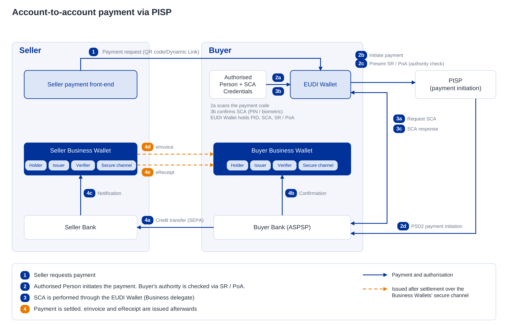
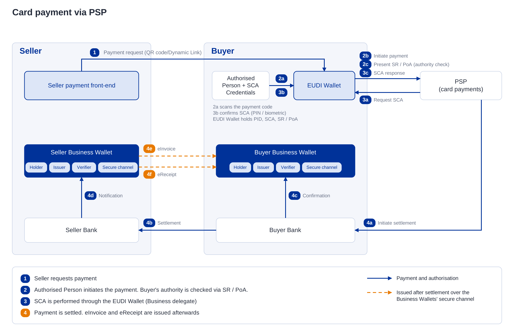

# PA4 Scenario 1.1: Onboarding and Tracker Baseline

## Change log

| Date | Author | Change | Baseline version |
|---|---|---|---|
| 2026&#8209;11&#8209;25 | Nikolaos Triantafyllou (UAegean), Lal Chandran (iGrant.io) | Baseline drafted from the PA4 flow redesign, pilot deck and payment diagrams | 0.1 |

**Use case / scenario:** PA4, Scenario 1.1 (deferred invoice). Variant 1.1a: account-to-account payment via PISP. Variant 1.1b: corporate card payment via PSP.

**Purpose:** Scenario baseline for onboarding the PA4 Scenario 1.1 partners. It states **what** is required for this scenario (roles, wallets, registrations, conformance blocks, credentials and MVP steps). **How** to do each step is described in the generic [WP4 onboarding guide](https://github.com/webuild-consortium/wp4-architecture/blob/main/onboarding/Onboarding.md); this document links to it rather than copying it. Each partner and role combination copies this baseline into its own tracker and records actual progress there, as described in the [WP4 onboarding README](https://github.com/webuild-consortium/wp4-architecture/blob/main/onboarding/README.md).

**Statuses:** ⚪ Not started · 🟡 In progress · ✅ Done · 🔴 Blocked · ➖ N/A · ❔ To confirm. **Test outcomes:** Not run / Pass / Fail / Blocked / Retest pending.

| Field | Value |
|---|---|
| Use case / scenario | `PA4-S1.1` (variants `1.1a` A2A, `1.1b` card) |
| Business case | Travel agency buys prepaid ferry credit (wholesale capacity) from Cyclades Fast Ferries; payment first, invoice and receipt afterwards |
| Use-case leads | 1.1a: Nikolaos Triantafyllou (UAegean). 1.1b: Lal Chandran (iGrant.io) |
| Baseline version | 0.1 (draft for review) |
| Last updated | 2026-11-25 |
| Overall status | 🟡 |

---

## 1.0 Scenario overview

### 1.1 Business process

Cyclades Fast Ferries (CFF) sells prepaid ferry credit to travel agencies. An agency tops up its prepaid balance, then consumes it as it issues individual ferry tickets to its own customers. The downstream retail ticketing is not part of the B2B payment.

Scenario 1.1 is a **deferred invoice** flow: the payment is made first, and the eReceipt and invoice artifacts are issued afterwards to the agency's Business Wallet (EBW).

The operating model follows the [PA4 flow redesign](https://docs.google.com/document/d/1sXDsE3i1DkEOse4v68pntqubDvm-X6NEdwNl7Q7x8xc/edit) (wallet-first order-to-cash):

| # | Step | Summary |
|---|---|---|
| 1 | Partner onboarding (one time) | The agency presents KYB and representation evidence from its EBW. CFF verifies identity, mandate and commercial eligibility, registers the agency and binds an authenticated EBW endpoint. CFF issues an Authorized Travel Agency VC. |
| 2 | Order Request VC | The agency EBW issues a signed Order Request VC for a prepaid credit top-up (partner ID, amount, currency, payment-method preference, authorization reference). |
| 3 | CFF verification | CFF's EBW checks integrity, issuer and signing key, credential status, partner relationship, mandate, idempotency and commercial rules. |
| 4 | Order Accepted VC | CFF records the order and issues an Order Accepted VC with the CFF order ID, accepted amount, expiry, payment request ID and hosted payment link. |
| 5 | Agency pending inbox | The agency EBW verifies the credential and shows it as a Pending Payment. |
| 6 | Human payment authorization | An authorised representative opens the payment link and completes the PA2 card or A2A journey (figures in section 1.3). Company approval and the bank's personal SCA are separate controls. |
| 7 | Payment confirmation | An authenticated bank, PSP or PISP notification reports the result. CFF checks the settled financial state; authorization alone is not a completed payment. |
| 8 | Ledger and receipt | CFF increases the agency's prepaid balance exactly once and issues a Payment Receipt VC (eReceipt). |
| 9 | Monthly accounting | CFF issues the fiscal invoice for consumed services and a self-billed commission invoice, and exchanges their credential representations or references with the agency EBW. (P1, see section 1.5.) |

CFF's booking, credit ledger, accounting archive and myDATA reporting remain authoritative. The wallets exchange verified records and references.

### 1.2 Responsibility split: PA4 and PA2

| PA4 (Business Wallet / B2B lifecycle) | PA2 A2 (payment and SCA layer) |
|---|---|
| Organisation onboarding and mutual verification | Payment initiation and PISP or PSP interaction |
| Business identity and trusted commercial relationship | Connection to the account-servicing bank (ASPSP) or card issuer |
| Authorised representation (SR / PoA) | Business bank account or corporate card as funding source |
| Order, invoice and eReceipt exchange between Business Wallets | Wallet-based SCA, transaction binding and confirmation |

The PA4-specific extension: the payer is a legal entity, while the wallet holder who approves the payment is an authorised natural person acting on its behalf. PA2 owns the payment profiles and their conformance (CS-12); PA4 reuses them and does not define a new bank authentication protocol.

### 1.3 Payment flows

The payment part of the flow (steps 6 to 8 above) for each variant. Editable source: [PA4 diagrams on excalidraw.igrant.io](https://excalidraw.igrant.io/editor/04042958-1be3-409d-9905-18dab87a65ef).

**Figure 1: Scenario 1.1a, account-to-account payment via PISP**

| Step | From → To | Action |
|---|---|---|
| 1 | Seller front-end → EUDI Wallet | Payment request (QR code or dynamic link) |
| 2a | Authorised Person → EUDI Wallet | Scans the payment code |
| 2b | EUDI Wallet → PISP | Initiates the payment |
| 2c | EUDI Wallet → PISP | Presents SR / PoA for the authority check |
| 2d | PISP → Buyer Bank (ASPSP) | PSD2 payment initiation |
| 3a, 3c | Buyer Bank ↔ EUDI Wallet | SCA request and signed SCA response |
| 3b | Authorised Person | Confirms SCA in the EUDI Wallet (PIN or biometric) |
| 4a | Buyer Bank → Seller Bank | Credit transfer (SEPA) |
| 4b, 4c | Banks → Business Wallets | Confirmation to the buyer, notification to the seller |
| 4d, 4e | Seller EBW → Buyer EBW | eInvoice and eReceipt over the Business Wallets' secure channel |

**Figure 2: Scenario 1.1b, corporate card payment via PSP**

| Step | From → To | Action |
|---|---|---|
| 1 | Seller front-end → EUDI Wallet | Payment request (QR code or dynamic link) |
| 2a | Authorised Person → EUDI Wallet | Scans the payment code |
| 2b | EUDI Wallet → PSP | Initiates the card payment |
| 2c | EUDI Wallet → PSP | Presents SR / PoA for the authority check |
| 3a, 3c | PSP ↔ EUDI Wallet | SCA request and SCA response |
| 3b | Authorised Person | Confirms SCA in the EUDI Wallet (PIN or biometric) |
| 4a | PSP → Buyer Bank | Initiates settlement |
| 4b | Buyer Bank → Seller Bank | Settlement |
| 4c, 4d | Banks → Business Wallets | Confirmation to the buyer, notification to the seller |
| 4e, 4f | Seller EBW → Buyer EBW | eInvoice and eReceipt over the Business Wallets' secure channel |

In both variants, no attestation is issued to the Authorised Person's EUDI Wallet; the eReceipt is a company-level artifact that lands in the agency's EBW.

### 1.4 Milestones

| Date | Milestone | Content |
|---|---|---|
| 31 Oct 2026 | Flow and actors locked | Fast Ferries and Travel Agency B2B flow finalised; A2A role split confirmed |
| 30 Nov 2026 | Core technical integration | Fast Ferries, Bootes, UAegean intermediary and iGrant.io Business Wallet integrated; PA2 A2 payment path connected |
| Dec 2026 | End-to-end pilot testing | B2B interoperability tests: business authority, payment initiation and SCA, payment confirmation, invoice and eReceipt exchange |
| 28 Feb 2027 | Demo-ready MVP | Agency buys capacity, authorised person approves, payment settles, eInvoice and eReceipt exchanged, credit available |
| Mar to Aug 2027 | Pilot extension and evidence | Further organisations or payment variants, trust and conformance coverage, metrics, final reporting |

### 1.5 Scope and priorities

| Priority | In scope for this baseline |
|---|---|
| P0 (MVP) | Partner onboarding, Order Request VC, Order Accepted VC with payment link, PA2 payment and SCA, payment confirmation, Payment Receipt VC (eReceipt) |
| P1 (MVP+) | Monthly fiscal invoice and self-billed commission invoice as credential representations or references; myDATA linkage |
| Out of scope | Home-bank onboarding (PA3); KYS / KYC processes (BU1); IBAN validation; a separate (Q)ERDS service for the initial demonstrator; issuance of any attestation to the Authorised Person's EUDI Wallet; Scenario 1.2 (upfront invoice) and the retail corporate-card scenario |

---

## Stage 1: Role identification

Business roles from the PA4 Scenario 1.1 pilot deck (pilot parties, slides 7 and 8). Technical roles follow the [generic Stage 1](https://github.com/webuild-consortium/wp4-architecture/blob/main/onboarding/Onboarding.md#stage-1--role-identification).

| Party | Variant | Business role | Technical role(s) | Wallet | Party status |
|---|---|---|---|---|---|
| Cyclades Fast Ferries (CFF) | 1.1a, 1.1b | Supplier / merchant (seller) | **Holder** (legal person: EBWOID, EUCC, VAT-ID). **Verifier/RP** (agency KYB and representation evidence, Order Request VC). **Issuer** (Authorized Travel Agency VC, Order Accepted VC, Payment Receipt VC, invoice references) | EBW (W1) | Confirmed |
| Travel Agency via Bootes | 1.1a | Buyer / distributor | **Holder** (legal person: EBWOID, EUCC, VAT-ID, Authorized Travel Agency VC, Order Accepted VC, Payment Receipt VC). **Issuer** (Order Request VC). **Verifier/RP** (CFF-issued transaction credentials) | EBW (W2) | Confirmed |
| Travel Agency (to be named) | 1.1b | Buyer / distributor | As 1.1a | EBW (W2) | Confirmed in deck; party ❔ |
| Authorised representative | 1.1a, 1.1b | Natural person acting for the agency | **Holder** (natural person: PID, SCA attestation, SR / PoA) | EUDI Wallet (W3) | Pilot role |
| UAegean i4m Lab | 1.1a, 1.1b | Technical coordinator / intermediary | **Intermediary** | As specified | Confirmed |
| iGrant.io | 1.1a, 1.1b | EUDI Wallet and Business Wallet provider | **Wallet Provider** | Provides W1 ❔, W2, W3 | Confirmed |
| Worldline Germany | 1.1a | PISP (PA2 A2 payment initiation) | **Verifier/RP** of SR / PoA from the EUDI Wallet (step 2c); PA2 payment roles | PA2 setup | PA2 A2 confirmed |
| Worldline Germany | 1.1b | PSP | **Verifier/RP** of SR / PoA (step 2c) and SCA response (step 3c); PA2 payment roles | PA2 setup | PA2 A2 confirmed |
| Air Bank (Czech Republic) | 1.1a | ASPSP / buyer's bank | **Issuer** of the SCA-IBAN attestation; SCA verifier (steps 3a, 3c) | PA2 setup | PA2 A2 confirmed |
| OP Bank (Finland) | 1.1b | Buyer's bank and corporate card issuer | **Issuer** of the SCA-Card (DPC) attestation | PA2 setup | PA2 A2 confirmed |

PA2 parties (Worldline, Air Bank, OP Bank) follow the PA2 onboarding; they are listed here so the PA4 partners know their counterparts.

| ID | Requirement | Status | Owner | Evidence |
|---|---|---|---|---|
| 1.1 | Business roles and variants confirmed (1.1a, 1.1b) | 🟡 | Use-case leads | Pilot deck, slides 7 and 8 |
| 1.2 | Technical roles and wallet assignment confirmed per party | ❔ | Use-case leads | This table |
| 1.3 | Travel agency for 1.1b named | ❔ | Lal Chandran | |
| 1.4 | EBW provider for CFF confirmed | ❔ | Use-case leads | |

**Exit criterion:** Roles and wallet requirements confirmed by both use-case leads.

---

## Stage 2: Wallet initialization and deployment

Procedure: [generic Stage 2](https://github.com/webuild-consortium/wp4-architecture/blob/main/onboarding/Onboarding.md#stage-2--wallet-initialization-and-deployment). Install the **EUDI Wallet first**: activating an EBW needs an EBWOID, and issuing the EBWOID needs the legal representative's PID in an EUDI Wallet.

| Wallet | Wallet type / purpose | MVP or MVP+ | Provider / version | Party / role | Status | Evidence |
|---|---|---|---|---|---|---|
| W1 | EBW for CFF (seller): holder, verifier and issuer of business transaction credentials | MVP | ❔ | CFF / Holder + Verifier + Issuer | ❔ | |
| W2 | EBW for the travel agency (buyer) | MVP | iGrant.io EBW, version ❔ | Travel Agency / Holder + Issuer + Verifier | ⚪ | |
| W3 | EUDI Wallet for the authorised representative: PID, SCA attestation, SR / PoA, payment SCA | MVP | iGrant.io EUDI Wallet, version ❔ | Authorised representative / Holder | ⚪ | |
| W4 | EUDI Wallet for each company's legal representative, to obtain EBWOID and EUCC | MVP | iGrant.io EUDI Wallet ❔ | CFF and Travel Agency legal representatives / Holder | ⚪ | May be the same person and wallet as W3 for the agency |

| ID | Wallet | Requirement | Status | Date | Evidence |
|---|---|---|---|---|---|
| 2.1 | W3, W4 | EUDI Wallet installed and active | ⚪ | | |
| 2.2 | W1 | CFF EBW installed, configured and endpoint reachable | ⚪ | | |
| 2.3 | W2 | Travel Agency EBW installed, configured and endpoint reachable | ⚪ | | |
| 2.4 | W1, W2 | EBW-to-EBW endpoint binding and discovery tested (P0, see Issues) | ⚪ | | |

**Record in partner tracker:** provider, app name, version, role, endpoint URL.

---

## Stage 3: ITB onboarding

Procedure: [generic Stage 3](https://github.com/webuild-consortium/wp4-architecture/blob/main/onboarding/Onboarding.md#stage-3--itb-onboarding) and the [ITB user guide](https://github.com/webuild-consortium/wp4-interop-test-bed/blob/main/docs/user-guide-interoperability-test-bed.md).

| ID | Party | Requirement | Status | Date | Evidence |
|---|---|---|---|---|---|
| 3.1 | CFF (or its EBW operator) | ITB portal access activated | ⚪ | | |
| 3.2 | Travel Agency / Bootes (or its EBW operator) | ITB portal access activated | ⚪ | | |
| 3.3 | iGrant.io | ITB portal access activated | ⚪ | | |
| 3.4 | All of the above | Joined `#itb-support` and reviewed the ITB user guide | ⚪ | | |

---

## Stage 4: ITB Basic Conformance (CS-Basic)

Procedure: [generic Stage 4](https://github.com/webuild-consortium/wp4-architecture/blob/main/onboarding/Onboarding.md#stage-4-itb-basic-conformance-cs-basic). Run once per wallet type (EBW and each EUDI Wallet implementation). The test case IDs are selected by the use-case leads; none are selected yet.

| ID | Wallet | Role | Block | Test case ID | Required? | Status | Result | Execution date | Evidence / issue |
|---|---|---|---|---|---|---|---|---|---|
| 4.1 | W1, W2 (EBW) | Holder (legal person) | CS-01 Issuance (Key Attestation required) | ❔ to be selected | ✅ | ⚪ | Not run | | |
| 4.2 | W1, W2 (EBW) | Holder (legal person) | CS-02 Presentation | ❔ to be selected | ✅ | ⚪ | Not run | | |
| 4.3 | W3 (EUDI) | Holder (natural person) | CS-01 Issuance | ❔ to be selected | ✅ | ⚪ | Not run | | |
| 4.4 | W3 (EUDI) | Holder (natural person) | CS-02 Presentation (PID, SR / PoA) | ❔ to be selected | ✅ | ⚪ | Not run | | |

---

## Stage 5: WEBUILD Trust List Registration

Procedure and registries: [generic Stage 5](https://github.com/webuild-consortium/wp4-architecture/blob/main/onboarding/Onboarding.md#stage-5--webuild-trust-list-registration), [Trusted Lists onboarding](https://github.com/webuild-consortium/wp4-trust-group/blob/main/task1-use-cases/subtask1-1-onboarding/trusted-lists-onboarding.md) and [Relying Party registry onboarding](https://github.com/webuild-consortium/wp4-trust-group/blob/main/task1-use-cases/subtask1-1-onboarding/relying-party-registry-onboarding.md).

| ID | Party / role / credential type | Registration / certificate requirement | Required? | Status | Owner | Registry / evidence / N/A reason |
|---|---|---|---|---|---|---|
| 5.1 | CFF as issuer of EBW credentials (Authorized Travel Agency VC, Order Accepted VC, Payment Receipt VC) | None unless the use case requires it (generic 5.2.7). Whether an Access Certificate is needed to issue to another business wallet is an open WP4 decision | ❔ | ⚪ | CFF | |
| 5.2 | CFF as verifier of EBW credentials (EBWOID, EUCC, VAT-ID, Order Request VC) | None unless the use case requires it (generic 5.1) | ➖ | ➖ | | EBW credentials only |
| 5.3 | CFF as verifier of EUDI credentials (representative's PID, SR / PoA), if verified at onboarding | Access Certificate + Registration Certificate via Raidiam (generic 5.1) | ❔ | ⚪ | CFF | Depends on question Q4 |
| 5.4 | Travel Agency as issuer of the Order Request VC and verifier of CFF credentials | None unless the use case requires it (generic 5.1, 5.2.7) | ❔ | ⚪ | Travel Agency | |
| 5.5 | Authorised representative (pure Holder) | No registry entries (holder exception) | ➖ | ➖ | | Pure Holder |
| 5.6 | Worldline (PISP / PSP) as verifier of EUDI credentials (SR / PoA, SCA) | Access Certificate + Registration Certificate via Raidiam | ✅ | ⚪ | Worldline (PA2) | Tracked by PA2 |
| 5.7 | Air Bank and OP Bank as SCA attestation issuers | `UseCase Bank SCA` or `UseCase DPC` trusted list, plus Access and Registration Certificates (generic 5.2.5) | ✅ | ⚪ | Banks (PA2) | Tracked by PA2 |
| 5.8 | UAegean i4m Lab as intermediary | Group 5 Trust Registry Infrastructure Access CA (generic 5.3) | ❔ | ⚪ | UAegean | |
| 5.9 | iGrant.io as wallet provider | `WEBUILD – Wallet Providers` (generic 5.4) | ✅ | ⚪ | iGrant.io | |
| 5.10 | Issuer of SR / PoA attestations | Depends on the issuer type (QEAA, PuB-EAA or EAA, generic 5.2) | ❔ | ⚪ | ❔ | Depends on question Q3 |

---

## Stage 6: Trust conformance (CS-Trust)

Procedure: [generic Stage 6](https://github.com/webuild-consortium/wp4-architecture/blob/main/onboarding/Onboarding.md#stage-6--trust-conformance-cs-trust). Cases to be selected by the use-case leads; business-wallet validation is still marked "to be confirmed" in the generic guidance.

| ID | Wallet | Role | Test case ID | Required? | Status | Result | Date | Evidence / defect |
|---|---|---|---|---|---|---|---|---|
| 6.1 | W1, W2 | EBW Holder, Verifier and Issuer | ❔ to be selected | ❔ | ⚪ | Not run | | |
| 6.2 | W3 | EUDI Holder | ❔ to be selected | ❔ | ⚪ | Not run | | |

---

## Stage 7: Sectorial-specific conformance

Procedure: [generic Stage 7](https://github.com/webuild-consortium/wp4-architecture/blob/main/onboarding/Onboarding.md#stage-7--sectorial-specific-conformance-use-case-dependent).

| ID | Wallet | Role | Block | Test case ID | Required? | Status | Result | Date | Evidence |
|---|---|---|---|---|---|---|---|---|---|
| 7.1 | W1 | CFF as Issuer | CS-Issuer (CS-01) | ❔ to be selected | ✅ | ⚪ | Not run | | Authorized Travel Agency VC and business transaction VCs |
| 7.2 | W2 | Travel Agency as Issuer | CS-Issuer (CS-01) | ❔ to be selected | ✅ | ⚪ | Not run | | Order Request VC |
| 7.3 | W3 | EUDI Holder | CS-12 SCA payments | Defined by PA2 | ✅ | ⚪ | Not run | | Tracked by PA2; PA4 dependency |
| 7.4 | All | | CS-Signature (CS-03) | | ➖ | ➖ | | | No QES step in Scenario 1.1 ❔ |
| 7.5 | W1, W2 | | CS-QERDS (CS-15 / CS-16) | | ➖ | ➖ | | | No (Q)ERDS in the initial demonstrator (see Issues, ISSUE-005) |

---

## Stage 8: Role-specific prerequisite provisioning

How to obtain each credential, import schemas and prepare DCQL: [generic Stage 8](https://github.com/webuild-consortium/wp4-architecture/blob/main/onboarding/Onboarding.md#stage-8--generic-prerequisite-provisioning-guidance). Rulebooks: [attestation rulebooks catalog](https://github.com/webuild-consortium/webuild-attestation-rulebooks-catalog/tree/main/rulebooks).

### 8.1 Credentials for Scenario 1.1

| Credential | Rulebook | Held in | Issued by | Verified by | Variant | Priority |
|---|---|---|---|---|---|---|
| PID | [rb-pid](https://github.com/webuild-consortium/webuild-attestation-rulebooks-catalog/tree/main/rulebooks/rb-pid) | W3, W4 (EUDI) | PID test issuer ❔ | CFF (onboarding) ❔, EBWOID issuer | 1.1a, 1.1b | P0 |
| EBWOID | [rb-ebwoid](https://github.com/webuild-consortium/webuild-attestation-rulebooks-catalog/tree/main/rulebooks/rb-ebwoid) | W1, W2 (EBW) | EBWOID issuer ❔ (Greek or generic test issuer) | CFF, Travel Agency | 1.1a, 1.1b | P0 |
| EUCC | [rb-eucc](https://github.com/webuild-consortium/webuild-attestation-rulebooks-catalog/tree/main/rulebooks/rb-eucc) | W1, W2 | EUCC issuer (generic: Bundesanzeiger) ❔ | CFF | 1.1a, 1.1b | P0 |
| VAT-ID | [rb-vat-id](https://github.com/webuild-consortium/webuild-attestation-rulebooks-catalog/tree/main/rulebooks/rb-vat-id) | W1, W2 | VAT-ID issuer ❔ | CFF | 1.1a, 1.1b | P0 |
| Authorised Signatories (SR) | [rb-authorised-signatories](https://github.com/webuild-consortium/webuild-attestation-rulebooks-catalog/tree/main/rulebooks/rb-authorised-signatories) | W3 (as shown in the figures) ❔ | Issuer ❔ | CFF (onboarding), PISP / PSP (step 2c) | 1.1a, 1.1b | P0 |
| EU PoA (scope: payment, limit) | [rb-eu-poa](https://github.com/webuild-consortium/webuild-attestation-rulebooks-catalog/tree/main/rulebooks/rb-eu-poa) | W3 | Issuer ❔ (Travel Agency EBW as delegating company?) | CFF (onboarding), PISP / PSP (step 2c) | 1.1a, 1.1b | P0 |
| SCA-IBAN | [rb-sca-iban](https://github.com/webuild-consortium/webuild-attestation-rulebooks-catalog/tree/main/rulebooks/rb-sca-iban) | W3 | Air Bank (PA2) | Air Bank, PISP | 1.1a | P0 |
| SCA-Card (DPC) | [rb-sca-card-dpc](https://github.com/webuild-consortium/webuild-attestation-rulebooks-catalog/tree/main/rulebooks/rb-sca-card-dpc) | W3 | OP Bank (PA2) | PSP | 1.1b | P0 |
| Authorized Travel Agency VC (proposed, no rulebook yet) | PA4 schema to be published | W2 | CFF (W1) | CFF | 1.1a, 1.1b | P0 |
| Order Request VC (Business Transaction VC) | PA4 schema to be published | W1 (delivered to CFF) | Travel Agency (W2) | CFF | 1.1a, 1.1b | P0 |
| Order Accepted VC (Business Transaction VC) | PA4 schema to be published | W2 | CFF (W1) | Travel Agency | 1.1a, 1.1b | P0 |
| Payment Receipt VC / eReceipt | [rb-e-receipt](https://github.com/webuild-consortium/webuild-attestation-rulebooks-catalog/tree/main/rulebooks/rb-e-receipt), profiled for prepaid top-ups | W2 | CFF (W1) | Travel Agency | 1.1a, 1.1b | P0 |
| Invoice and commission references | PA4 schema to be published | W2 | CFF (W1) | Travel Agency | 1.1a, 1.1b | P1 |
| IBAN-OV (optional) | [rb-iban-ov](https://github.com/webuild-consortium/webuild-attestation-rulebooks-catalog/tree/main/rulebooks/rb-iban-ov) | W1 | Bank ❔ | Travel Agency | 1.1a | P1 |
| Payment Terms (optional) | [rb-payment-terms](https://github.com/webuild-consortium/webuild-attestation-rulebooks-catalog/tree/main/rulebooks/rb-payment-terms) | W2 | CFF ❔ | Travel Agency | 1.1a, 1.1b | P1 |

**Dependency order:** PID → EBWOID → EUCC and VAT-ID → SR / PoA → Authorized Travel Agency VC → business transaction VCs. SCA attestations (PA2) are needed before the first payment run.

### 8.2 Provisioning tasks per role

| ID | Party / role | Credential / prerequisite | Requirement | Required? | Status | Owner | Evidence / dependency |
|---|---|---|---|---|---|---|---|
| 8.1 | Legal representatives (CFF, Travel Agency) / Holder | PID | Obtain in W4 | ✅ | ⚪ | | Generic 8.2.1 |
| 8.2 | CFF / Holder | EBWOID, EUCC, VAT-ID | Obtain in W1 | ✅ | ⚪ | CFF | Needs 8.1 |
| 8.3 | Travel Agency / Holder | EBWOID, EUCC, VAT-ID | Obtain in W2 | ✅ | ⚪ | Travel Agency | Needs 8.1 |
| 8.4 | Authorised representative / Holder | PID, SR / PoA | Obtain in W3 | ✅ | ⚪ | | Issuer of SR / PoA ❔ |
| 8.5 | Authorised representative / Holder | SCA-IBAN (1.1a) or SCA-Card DPC (1.1b) | Obtain in W3 from the PA2 bank | ✅ | ⚪ | PA2 bank | Business-account permissions at the bank |
| 8.6 | CFF / Verifier | EBWOID, EUCC, VAT-ID, SR / PoA, PID ❔ | Import schemas, prepare DCQL for partner onboarding | ✅ | ⚪ | CFF | |
| 8.7 | CFF / Issuer | Authorized Travel Agency VC | Configure schema, test data and issuance | ✅ | ⚪ | CFF | Schema to be published by PA4 |
| 8.8 | CFF / Verifier | Order Request VC | Import schema; validate integrity, issuer, status, partner, mandate and idempotency | ✅ | ⚪ | CFF | |
| 8.9 | CFF / Issuer | Order Accepted VC with hosted payment link | Configure schema, payment link creation and issuance | ✅ | ⚪ | CFF | PSP / PISP link integration (ISSUE-003) |
| 8.10 | CFF / Issuer | Payment Receipt VC / eReceipt | Configure schema and issuance after ledger posting | ✅ | ⚪ | CFF | eReceipt rulebook profile |
| 8.11 | Travel Agency / Issuer | Order Request VC | Configure schema and issuance | ✅ | ⚪ | Travel Agency | |
| 8.12 | Travel Agency / Verifier | Order Accepted VC, Payment Receipt VC, Authorized Travel Agency VC | Import schemas; pending-payment inbox | ✅ | ⚪ | Travel Agency | |
| 8.13 | PISP / PSP / Verifier | SR / PoA from W3 | Import schema and DCQL (step 2c) | ✅ | ⚪ | Worldline (PA2) | |
| 8.14 | CFF / Issuer | Invoice and commission references | Configure schemas and issuance | ❔ | ⚪ | CFF | P1 |

---

## Readiness gate (before Stage 9)

| Check | Status | Evidence / approved exception |
|---|---|---|
| Applicable Stages 1 to 8 complete or exceptions approved | ⚪ | |
| No critical unresolved blocker preventing MVP execution | ⚪ | |
| Use-case leads authorize Stage 9 execution | ⚪ | |

---

## Stage 9: MVP interoperability execution and sign-off

Execution results are recorded only in the partner trackers derived from this baseline.

### Approved scenario test steps

| Test ID | Scenario step | Participants | Expected result / acceptance criterion | Variant | Required? |
|---|---|---|---|---|---|
| MVP-01 | Partner onboarding | Travel Agency (W2, W3), CFF (W1) | CFF verifies EBWOID, EUCC, VAT-ID and representation evidence; agency registered; EBW endpoint bound; Authorized Travel Agency VC issued to W2 | 1.1a, 1.1b | ✅ |
| MVP-02 | Order Request VC | Travel Agency (W2) → CFF (W1) | Signed Order Request VC (`order_type = PREPAID_CREDIT_TOPUP`) received by CFF | 1.1a, 1.1b | ✅ |
| MVP-03 | CFF verification | CFF (W1) | Integrity, issuer key, status, partner, mandate, idempotency and commercial rules checked; invalid or duplicate requests rejected | 1.1a, 1.1b | ✅ |
| MVP-04 | Order Accepted VC and pending payment | CFF (W1) → Travel Agency (W2) | Order Accepted VC with CFF order ID, amount, expiry and payment link received, verified and shown as Pending Payment | 1.1a, 1.1b | ✅ |
| MVP-05 | Payment initiation and authority check | W3, PISP or PSP | Payment request scanned (step 2a); payment initiated (2b); SR / PoA presented and accepted (2c); for 1.1a, PSD2 initiation reaches the ASPSP (2d) | 1.1a, 1.1b | ✅ |
| MVP-06 | SCA | W3, bank or PSP | SCA requested and presented via the EUDI Wallet before settlement (steps 3a to 3c) | 1.1a, 1.1b | ✅ |
| MVP-07 | Settlement and confirmation | Banks, PSP / PISP, CFF | Settlement completed (4a, 4b); CFF correlates the confirmed financial state with the order; authorization alone is not treated as paid | 1.1a, 1.1b | ✅ |
| MVP-08 | Ledger posting and eReceipt | CFF (W1) → Travel Agency (W2) | Prepaid balance increased exactly once; Payment Receipt VC / eReceipt received and verified in W2; nothing issued to W3 | 1.1a, 1.1b | ✅ |
| MVP-09 | eInvoice / invoice reference | CFF (W1) → Travel Agency (W2) | Invoice credential or reference received over the secure channel and linked to the authoritative invoice by document ID and digest | 1.1a, 1.1b | ❔ (P1, see Q1) |
| MVP-10 | Self-billed commission invoice | CFF (W1) → Travel Agency (W2) | Self-billed invoice credential received and accepted by the agency | 1.1a, 1.1b | ➖ (P1) |
| MVP-11 | Single session | All | Scenario completes end to end in one sequential user session | 1.1a, 1.1b | ✅ |

### Actual execution runs (append every run and retest)

| Run ID | Test ID | Date | Partner / wallet version | Actual result | Outcome | Evidence / log | Defect ID | Retest of | Executor |
|---|---|---|---|---|---|---|---|---|---|
| RUN-001 | | | | | Not run | | | | |

### Acceptance and sign-off

| Criterion | Status | Evidence / approver / date |
|---|---|---|
| All mandatory scenario test steps passed (1.1a) | ⚪ | Nikolaos Triantafyllou |
| All mandatory scenario test steps passed (1.1b) | ⚪ | Lal Chandran |
| Critical defects resolved or formally waived | ⚪ | |
| Evidence links complete and reviewed | ⚪ | |
| Use-case lead final sign-off | ⚪ | |

---

## Open questions

Points the source documents do not settle. Each needs a decision by the use-case leads before the matching rows above can move from ❔.

| ID | Question | Affects |
|---|---|---|
| Q1 | **When is the eInvoice issued?** The payment figures show the eInvoice right after settlement (1.1a step 4d, 1.1b step 4e). The flow redesign issues only a Payment Receipt VC after the top-up and produces the fiscal invoice monthly, for consumed tickets, alongside the self-billed commission invoice. Which applies to the MVP? | Section 1.3, MVP-09 |
| Q2 | **How does the payment request reach the authorised representative?** The figures show the seller front-end sending a QR code or dynamic link to the EUDI Wallet (step 1). The redesign sends the payment link inside the Order Accepted VC to the agency EBW. Is step 1 the representative opening that link, and should the figures show the Order Request and Order Accepted steps? | Section 1.3, MVP-04, MVP-05 |
| Q3 | **Who issues the SR / PoA, and where is it held?** The figures place SR / PoA in the representative's EUDI Wallet. Is the PoA issued by the agency's EBW to the representative, and is SR held by the agency EBW or the EUDI Wallet? | 5.10, 8.1, 8.4 |
| Q4 | **Does CFF verify the representative's PID and PoA directly from the EUDI Wallet at onboarding?** If yes, CFF needs an Access Certificate and Registration Certificate. | 5.3, 8.6 |
| Q5 | **Which EBW does CFF use, and which travel agency takes part in 1.1b?** | Stage 1 rows 1.3, 1.4; wallet W1 |
| Q6 | **Which ITB test case IDs apply** for CS-Basic, CS-Trust and CS-Issuer for each wallet? | Stages 4, 6, 7 |
| Q7 | **Which PID and EBWOID issuers** do the parties use (Greek country issuers or generic test issuers)? | 8.1 |
| Q8 | **Should the Authorized Travel Agency VC carry the EBW endpoint binding?** The redesign lists key and endpoint binding as a claim. Alternatively the delivery endpoint is resolved by the wallets and kept out of the long-lived credential. | 8.7, ISSUE-001 |
| Q9 | **Is the retail corporate-card scenario covered by this baseline?** It is listed as Scenario 1.3 in the pilot deck and is out of scope here for now. | Section 1.5 |

## Issues and blockers

Pre-filled from the open implementation requirements in the PA4 flow redesign (section 6.4) and the pilot deck.

| ID | Stage / test | Description | Severity | Owner | Status |
|---|---|---|---|---|---|
| ISSUE-001 | 2.4, MVP-02 to MVP-08 | EBW-to-EBW delivery: endpoint binding and discovery, offer and notification transport, acknowledgment, retries, replay protection, deduplication, audit logs. Confirm the OID4VCI issuer/holder flow or a complementary transport | P0 | ❔ | ⚪ |
| ISSUE-002 | 8.4, MVP-05 | Authority binding: bind the legal entity and business account, the authorised natural person and the payment-authorisation rights (SR / PoA scope, amount limits, approval rules). Confirm which PA2 bank supports the business-account credential and SCA journey | P0 | ❔ | ⚪ |
| ISSUE-003 | 8.9, MVP-04, MVP-07 | Payment integration: PSP / PISP link creation, binding of order and payment IDs and amounts, webhook authentication, settled/paid semantics, refunds, exactly-once ledger posting. Generic payment links do not by themselves support PA2 wallet-based SCA | P0 | ❔ | ⚪ |
| ISSUE-004 | 8.7 to 8.12 | Publish JSON schemas, credential type identifiers, examples and conformance checks for the Business Transaction VC envelope and types | P1 | ❔ | ⚪ |
| ISSUE-005 | 7.5 | Exchanging business documents as credentials (no (Q)ERDS) deviates from the WP4 business-document ADR; needs a PA4 extension proposal and WP4 architecture agreement | P1 | ❔ | ⚪ |
| ISSUE-006 | MVP-09, MVP-10 | Fiscal artifact handling: invoice and credit-note immutability, myDATA, self-billing, archival retention; legal review of EBW delivery | P1 | ❔ | ⚪ |

---

## References

- Generic process: [WP4 onboarding guide](https://github.com/webuild-consortium/wp4-architecture/blob/main/onboarding/Onboarding.md), [tracking template](https://github.com/webuild-consortium/wp4-architecture/blob/main/onboarding/Tracking_template.md)
- PA4 sources: [PA4 flow redesign](https://docs.google.com/document/d/1sXDsE3i1DkEOse4v68pntqubDvm-X6NEdwNl7Q7x8xc/edit), [PA4 Scenario 1.1 pilot deck](https://docs.google.com/presentation/d/1i810I7pC_q6tKayXwxe9RWbDqNEP7eHLlDkOFLOt0BU/edit), [PA4 sequence diagrams](https://github.com/webuild-consortium/wp3-technology-standards/blob/main/sequence-diagrams/PA4/README.md), [diagram source](https://excalidraw.igrant.io/editor/04042958-1be3-409d-9905-18dab87a65ef)
- Conformance specifications: [CS-01 issuance](https://github.com/webuild-consortium/wp4-architecture/blob/main/conformance-specs/cs-01-credential-issuance.md), [CS-02 presentation](https://github.com/webuild-consortium/wp4-architecture/blob/main/conformance-specs/cs-02-credential-presentation.md), [CS-12 SCA payments](https://github.com/webuild-consortium/wp4-architecture/blob/main/conformance-specs/cs-12-sca-payments.md), [business-document ADR](https://github.com/webuild-consortium/wp4-architecture/blob/main/adr/adr-qeaa-attestations-qerds-documents.md)
- Prototype: [fast-ferries-pa4](https://github.com/endimion/fast-ferries-pa4)
