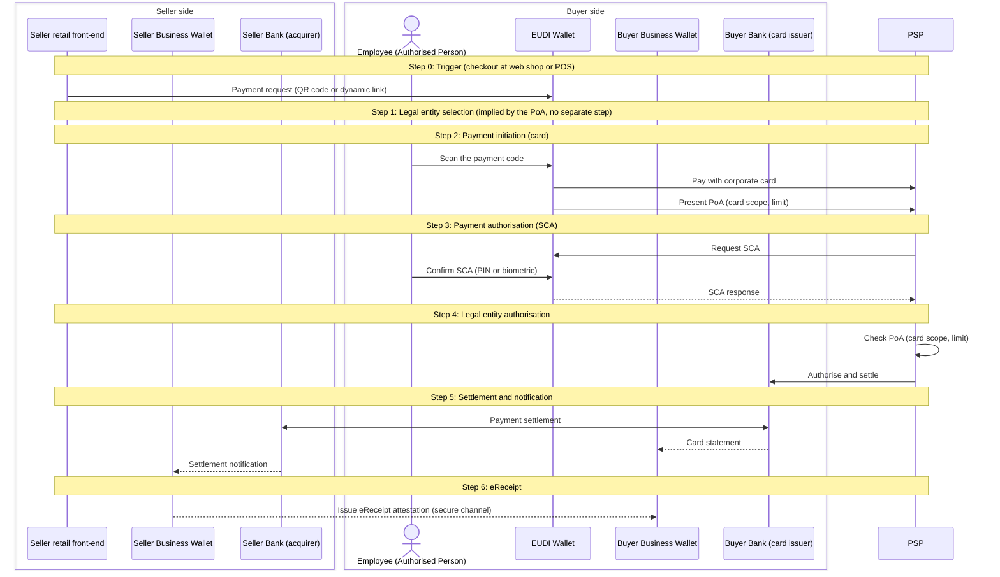

# Scenario 1.3: No invoice, card payment (retail)

A company employee buys at a web shop or point of sale and pays with the corporate card through their EUDI Wallet. The PSP checks the employee's authority through a Power of Attorney (PoA) with card scope and limit, and performs SCA through the EUDI Wallet. No invoice is issued at any point. After settlement the Buyer Bank sends a card statement to the Buyer Business Wallet and the Seller issues the eReceipt to the Buyer Business Wallet over the secure channel between the two business wallets. It follows the payment-first order of [Scenario 1.1](../scenario-1.1/), restricted to the card rail and without any invoice. Overview and shared context: [repository README](../README.md).

## Steps

| Step | Name                               | What happens                                                                                                                                      |
| ---- | ---------------------------------- | ------------------------------------------------------------------------------------------------------------------------------------------------- |
| 0    | Trigger                            | Seller retail front-end (web shop or POS) presents a payment request as QR code or dynamic link at checkout                                       |
| 1    | Legal entity selection             | No separate step. The company is identified by the PoA the employee presents in Step 2                                                            |
| 2    | Payment initiation                 | Employee scans the payment code with the EUDI Wallet; the wallet pays with the corporate card at the PSP and presents the PoA (card scope, limit) |
| 3    | Payment authorisation              | PSP requests SCA from the EUDI Wallet; employee confirms with PIN or biometric; the wallet returns the SCA response                               |
| 4    | Legal entity payment authorisation | PSP checks the PoA (card scope, limit) presented in Step 2, then sends authorise and settle to the Buyer Bank                                     |
| 5    | Settlement and notification        | Buyer Bank settles with Seller Bank and sends a card statement to the Buyer Business Wallet; Seller Bank notifies the Seller Business Wallet      |
| 6    | eReceipt issuance                  | Seller Business Wallet issues the eReceipt to the Buyer Business Wallet over the secure channel. No invoice is issued                             |

- Inputs: PID, SCA attestation and PoA (card scope, limit) in the employee's EUDI Wallet; corporate card issued by the Buyer Bank.
- Outputs: settled card payment; card statement and eReceipt in the Buyer Business Wallet. No invoice.
- Errors: code scan failure aborts before payment; PoA missing, out of scope or over limit stops the payment at the PSP; SCA failure or issuer decline stops authorisation. Nothing is issued unless settlement succeeds.

## Sequence diagram

