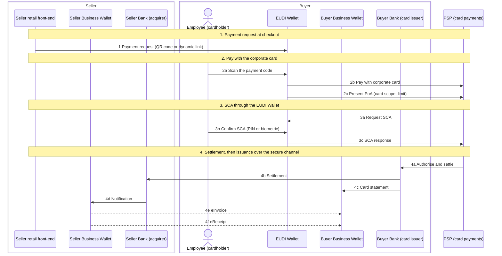

# Scenario 1.3: No invoice, card payment (retail)

A company employee buys at a web shop or point of sale and pays with the corporate card through their EUDI Wallet. No invoice exists before payment. The PSP checks the employee's authority through a Power of Attorney (PoA) with card scope and limit, and performs SCA through the EUDI Wallet. After settlement the Seller issues the eInvoice and the eReceipt to the Buyer Business Wallet over the secure channel between the two business wallets. Overview and shared context: [repository README](../README.md).

This scenario is not part of the upstream PA4 v1.0 specification. It is the retail profile of the deferred-invoice flow in [Scenario 1.1](../scenario-1.1/), restricted to the card rail.

## Actors

| Actor / System          | Side   | Role                                                        | Wallet / credentials                          |
| ----------------------- | ------ | ----------------------------------------------------------- | --------------------------------------------- |
| Seller retail front-end | Seller | Web shop or POS that issues the payment request             | n/a                                           |
| Seller Business Wallet  | Seller | Holder, issuer and verifier; issues eInvoice and eReceipt   | Active EBW                                    |
| Seller Bank             | Seller | Acquirer side of the card settlement                        | n/a                                           |
| Employee (cardholder)   | Buyer  | Authorised Person acting for the Buyer                      | EUDI Wallet with PID, SCA attestation and PoA |
| EUDI Wallet             | Buyer  | Scans the payment request, pays, presents PoA, performs SCA | PID, SCA attestation, PoA                     |
| Buyer Business Wallet   | Buyer  | Receives card statement, eInvoice and eReceipt              | Active EBW                                    |
| Buyer Bank              | Buyer  | Card issuer; authorises and settles                         | n/a                                           |
| PSP                     | Shared | Card payment processor; verifies PoA and requests SCA       | n/a                                           |

## Steps

| Step | From                    | To                     | What happens                                                                  |
| ---- | ----------------------- | ---------------------- | ----------------------------------------------------------------------------- |
| 1    | Seller retail front-end | EUDI Wallet            | Payment request as QR code or dynamic link at checkout                        |
| 2a   | Employee                | EUDI Wallet            | Scans the payment code                                                        |
| 2b   | EUDI Wallet             | PSP                    | Pays with the corporate card                                                  |
| 2c   | EUDI Wallet             | PSP                    | Presents the PoA (card scope, limit); the PSP checks the employee's authority |
| 3a   | PSP                     | EUDI Wallet            | Requests SCA                                                                  |
| 3b   | Employee                | EUDI Wallet            | Confirms SCA with PIN or biometric                                            |
| 3c   | EUDI Wallet             | PSP                    | Returns the SCA response                                                      |
| 4a   | PSP                     | Buyer Bank             | Authorise and settle                                                          |
| 4b   | Buyer Bank              | Seller Bank            | Settlement                                                                    |
| 4c   | Buyer Bank              | Buyer Business Wallet  | Card statement                                                                |
| 4d   | Seller Bank             | Seller Business Wallet | Settlement notification                                                       |
| 4e   | Seller Business Wallet  | Buyer Business Wallet  | eInvoice, issued after settlement over the secure channel                     |
| 4f   | Seller Business Wallet  | Buyer Business Wallet  | eReceipt, issued after settlement over the secure channel                     |

- Inputs: payment request from the Seller; PID, SCA attestation and PoA in the employee's EUDI Wallet; corporate card issued by the Buyer Bank.
- Outputs: settled card payment; card statement, eInvoice and eReceipt in the Buyer Business Wallet.
- Errors: code scan failure aborts before payment; PoA missing, out of scope or over limit stops the payment at the PSP; SCA failure or issuer decline stops authorisation. Nothing is issued to the Buyer Business Wallet unless settlement succeeds.

## Attestations

Proposed mapping to the [WE BUILD attestation rulebooks catalog](https://github.com/webuild-consortium/webuild-attestation-rulebooks-catalog). To be confirmed.

| Step   | Attestation                           | Issuer                 | Holder                | Verifier | Rulebook                                                                                                                                                                                                                                           |
| ------ | ------------------------------------- | ---------------------- | --------------------- | -------- | -------------------------------------------------------------------------------------------------------------------------------------------------------------------------------------------------------------------------------------------------- |
| 2b     | Corporate card credential             | Buyer Bank             | Employee EUDI Wallet  | PSP      | [rb-sca-card-dpc](https://github.com/webuild-consortium/webuild-attestation-rulebooks-catalog/tree/main/rulebooks/rb-sca-card-dpc)                                                                                                                 |
| 2c     | Power of Attorney (card scope, limit) | Buyer                  | Employee EUDI Wallet  | PSP      | [rb-eu-poa](https://github.com/webuild-consortium/webuild-attestation-rulebooks-catalog/tree/main/rulebooks/rb-eu-poa) or [rb-poa-pox](https://github.com/webuild-consortium/webuild-attestation-rulebooks-catalog/tree/main/rulebooks/rb-poa-pox) |
| 3b, 3c | SCA attestation                       | Buyer Bank             | Employee EUDI Wallet  | PSP      | [rb-sca-user](https://github.com/webuild-consortium/webuild-attestation-rulebooks-catalog/tree/main/rulebooks/rb-sca-user)                                                                                                                         |
| 4e     | eInvoice                              | Seller Business Wallet | Buyer Business Wallet | Buyer    | [rb-eInvoice](https://github.com/webuild-consortium/webuild-attestation-rulebooks-catalog/tree/main/rulebooks/rb-eInvoice)                                                                                                                         |
| 4f     | eReceipt                              | Seller Business Wallet | Buyer Business Wallet | Buyer    | [rb-e-receipt](https://github.com/webuild-consortium/webuild-attestation-rulebooks-catalog/tree/main/rulebooks/rb-e-receipt)                                                                                                                       |

## Sequence diagram

## Differences from Scenario 1.1

- Card rail only; no IBAN branch.
- The PoA is presented by the employee's EUDI Wallet to the PSP. In the upstream flow the PSP checks the PoA against the Buyer Business Wallet.
- The Buyer Bank sends a card statement to the Buyer Business Wallet. The upstream flow has no such step.
- eInvoice and eReceipt are issued over the secure channel between the two business wallets.

## Acceptance criteria

- [ ] Payment request is consumed by the EUDI Wallet from a QR code or dynamic link.
- [ ] PoA with card scope and limit is verified by the PSP before authorisation.
- [ ] SCA is requested and confirmed through the employee's EUDI Wallet before authorisation.
- [ ] Payment is authorised by the Buyer Bank and settled to the Seller Bank.
- [ ] Buyer Business Wallet receives the card statement, the eInvoice and the eReceipt after settlement.
- [ ] Nothing is issued to the Buyer Business Wallet if settlement fails.

## Open points

- Where the PoA lives and who issues it to the employee's EUDI Wallet. The upstream specification states that no attestation is issued to the EUDI Wallet.
- Which PoA rulebook applies: EU PoA or PoA with Proof of Existence.
- Whether retail issues an eInvoice at all, or only the eReceipt.
- What the card statement (4c) is and whether it is an attestation.
- Protocol binding of the secure channel between the business wallets (4e, 4f).
- Same-device versus cross-device handling of the payment request (1, 2a).
- Scope boundary with Scenario 1.1, which currently also covers the card rail for a deferred invoice.
